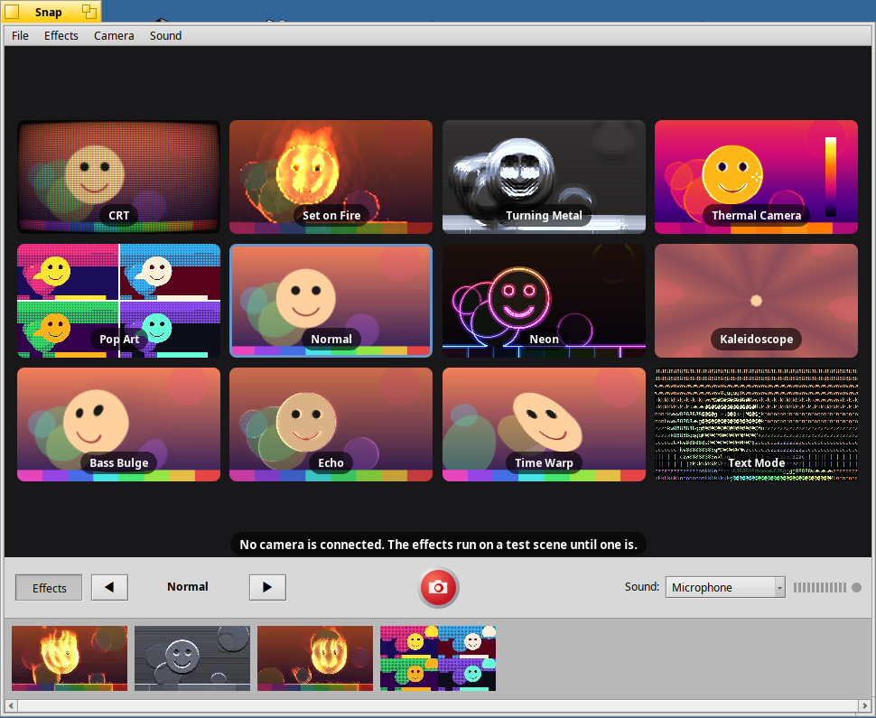
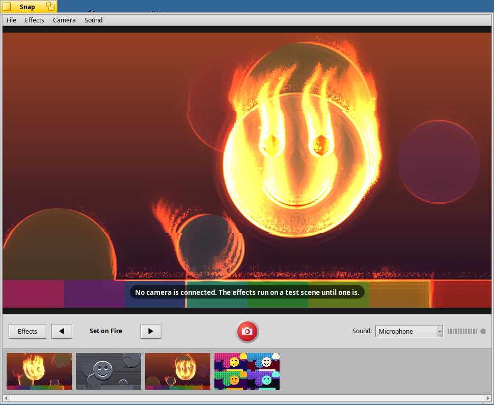

# Snap

A photo booth for air/OS. Snap shows the camera's picture through live
effects drawn by the graphics card and takes photos of them. Some effects
react to the sound around you, or to music Snap plays.



Snap is in **Deskbar › Demos**. It is also a demo in the other sense: a
small, complete program built only on Haiku's own APIs (the Media Kit,
the OpenGL Kit, the Game Kit, the Translation Kit, the Storage Kit's
attributes and node monitor, and scripting), written to be read. The
[API tour](#a-tour-of-the-apis) below says where to look for each.

## Effects

| Effect | What it does | With sound |
|---|---|---|
| CRT | An old television: curved glass, scanlines, an RGB shadow mask, phosphor glow, a hum bar | Noise shakes the picture and fills it with static; a beat makes it roll |
| Set on Fire | Flames rise from whatever moves and from your outline (a heat simulation that runs on the GPU) | Bass and loud sound feed the fire |
| Turning Metal | You turn into polished chrome from the top down; the surface's shape comes from the picture's shading | A beat sends a ripple across the metal |
| Thermal Camera | A heat camera's view; whatever moves glows hotter | The scene warms up with the noise in the room |
| Pop Art | Four silkscreen prints in loud colours with halftone dots | The colours move along on every beat |
| Normal | The camera as it is | |
| Neon | Your outlines as glowing neon tubes, with an equalizer | The equalizer shows the spectrum; treble makes the tubes flare |
| Kaleidoscope | Eight mirrored slices of the middle of the picture | Turns faster the louder it is; zooms with the bass |
| Bass Bulge | A fish-eye bulge in the middle | Swells with the bass; a beat sends out a ripple |
| Echo | Whatever moves leaves rainbow trails | Trails last longer when it is loud; a beat changes their colour |
| Time Warp | Each row is from a different moment: the top is now, the bottom 1.5 s ago | Sound bends the border between now and then |
| Text Mode | The picture in characters of the system's fixed font | A beat flashes the screen phosphor green |



(Both pictures show the test scene Snap runs its effects on until a camera
is connected.)

CRT, Set on Fire and Turning Metal take their names from
[OpenEffect](https://github.com/openeffect/openeffect), whose effects are
generated by AI video models in the cloud. Snap's versions are written from
scratch as GLSL shaders that run live, 60 times a second, on your own GPU.

## Using Snap

- **Effects** (Command-G) shows all twelve effects at once, live. Click one
  to use it. The arrows, the Left and Right keys, Command-1 to Command-0 and
  the Effects menu change the effect too.
- The red button, **Space** or Command-T takes a photo after a 3-2-1
  countdown, with a flash and a shutter sound. The countdown, the flash and
  the mirror image can be turned off in the Camera menu.
- Photos are PNG files in `~/Pictures/Snap`. They appear in the strip under
  the stage: double-click to open one, drag it out to Tracker or another
  program, right-click for "Show in Tracker" and "Move to Trash".
- **Sound** picks what the effects listen to: the microphone, music (Snap
  plays a sound file; drop one on the window or use Sound › Choose Music…),
  or nothing. Sound › Microphone Input chooses which input, for example a
  webcam's own microphone; the default is the one set in Media preferences.
  The lights next to the pop-up show the level, and the dot blinks on every
  beat.
- With more than one camera, the Camera menu lists them. A camera plugged
  in while Snap runs is picked up; until there is one, the effects run on a
  test scene.

Snap needs a graphics card with hardware 3D acceleration and OpenGL 3.1
(GLSL 1.40). On a computer that draws OpenGL in software it explains why
and quits. It runs on any Haiku with such a GPU; on air/OS that is AMD
(radeonsi), NVIDIA (Zink on NVK), the ROCK 5 (Panfrost) and the Pi 4 (V3D).

### Scripting

Everything can be done from a Terminal with `hey`:

```sh
hey Snap get Effects                    # the names of all effects
hey Snap set Effect to "Set on Fire"    # by name, id ("fire") or index
hey Snap set Grid to true
hey Snap set Sound to microphone        # off, microphone or music
hey Snap set Music to /boot/home/Music/song.mp3
hey Snap get Level                      # loudness 0..1; also: get Beats
hey Snap set Countdown to false
hey Snap do Photo                       # answers with the photo's path
hey Snap count Photos
hey Snap get Renderer                   # e.g. "AMD Radeon 760M (radeonsi, ...)"
```

`hey Snap getsuites` lists them with their descriptions.

## A tour of the APIs

| To see... | Read |
|---|---|
| A camera through the Media Kit: finding live producer nodes, `BMediaRecorder` for raw video, format negotiation, freeing outputs left by crashed programs | `src/capture/CameraSource.cpp`, `src/capture/MediaNodes.cpp` |
| Hot-plugged cameras: `BMediaRoster::StartWatching()` | `SnapWindow::_CamerasChanged()` in `src/app/SnapWindow.cpp` |
| Handing pictures between threads without waiting (triple buffering) | `src/capture/FrameExchange.cpp` |
| The microphone: `BMediaRecorder` on the default sound input | `src/audio/MicrophoneInput.cpp` |
| Decoding and playing a sound file: `BMediaFile`, `BMediaTrack`, `BSoundPlayer` | `src/audio/MusicPlayer.cpp` |
| Short sound effects with the Game Kit: `BSimpleGameSound` | `src/audio/SoundEffects.cpp` |
| Sound analysis (FFT, bands, beat detection), plain C++ | `src/audio/AudioAnalyzer.cpp` |
| OpenGL with `BGLView` from a render thread: `LockGL()`, `SwapBuffers()`, resizing | `src/ui/StageView.cpp` |
| Checking for a hardware GPU before opening a window | `src/app/GPUCheck.cpp` |
| GLSL effects, offscreen frame buffers, feedback effects, texture arrays | `src/render/`, `src/effects/` |
| Shaders stored as application resources and read with `BResources` | `resources/Snap.rdef`, `Makefile`, `src/render/ShaderLibrary.cpp` |
| Text and glyphs drawn by app_server into a `BBitmap`, used as GL textures | `src/render/TextTexture.cpp` |
| Saving with the Translation Kit (PNG, WebP), attributes, Tracker thumbnails | `src/photos/PhotoLibrary.cpp` |
| A folder kept in view with the node monitor; drag and drop of files; opening files with their preferred application; Tracker's Trash | `src/ui/PhotoStrip.cpp` |
| Custom controls drawn with gradients and shapes; `Pulse()` | `src/ui/Controls.cpp` |
| Layouts, menus, `BFilePanel`, settings as a flattened `BMessage` | `src/app/SnapWindow.cpp`, `src/app/Settings.cpp` |
| A scripting suite: `ResolveSpecifier()`, `GetSupportedSuites()`, `BPropertyInfo`, replying later | `src/app/SnapWindow.cpp`, `src/app/SnapApp.cpp` |

[docs/DESIGN.md](docs/DESIGN.md) explains how the parts fit together and why,
and [docs/EFFECTS.md](docs/EFFECTS.md) how to write a new effect.

## Building

On Haiku or air/OS, with the development tools that come with the system:

```sh
make            # build-haiku/Snap
make package    # artifacts/snap-<version>-<arch>.hpkg
make check      # the unit tests
```

From Linux, with the air/OS cross compiler and sysroot:

```sh
tools/build-cross.sh            # build-cross/Snap
make check-host                 # unit tests and a GLSL check of every shader
```

The air/OS images get Snap from the air/OS build server; see
[docs/TESTING.md](docs/TESTING.md) for testing without a camera or a GPU.

## License

MIT; see [LICENSE](LICENSE).
